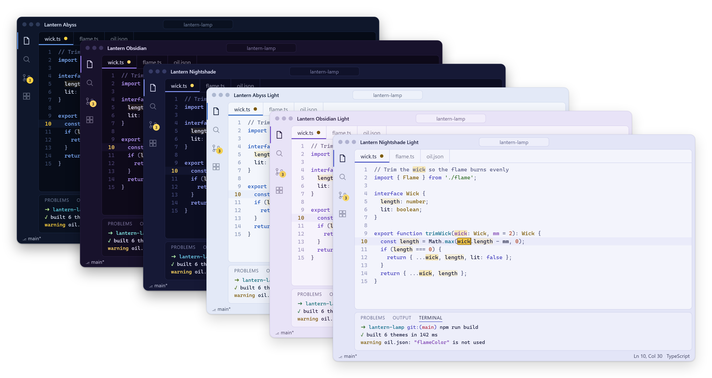

# Lantern

Three very dark blue and violet themes for VS Code, lit with gold, and a near-white light twin for each.



The backgrounds stay deep and cool, so the things you look for stand out in gold: the cursor, the active line number, your selection, find matches, other occurrences of the word under the cursor, badges, buttons and popups. Tabs, focus borders and the activity bar indicator use a soft light blue or violet.

## Variants

Open the Color Theme picker (`Ctrl+K Ctrl+T`, or `Cmd+K Cmd+T` on macOS) and choose one:

| Theme | Shade | Editor | Accent | Gold |
|---|---|---|---|---|
| **Lantern Nightshade** | Dark blue-violet | `#0c0e22` | `#8a9cff` | `#ffd75f` |
| **Lantern Obsidian** | Near-black purple | `#0e0a1a` | `#9f84ff` | `#ffd166` |
| **Lantern Abyss** | Near-black blue | `#070c18` | `#6ea8ff` | `#ffd23f` |

### Light themes

Each dark theme has a light twin. The backgrounds keep the hue of the dark theme and are lifted almost to white, so only a hint of the color remains. Gold can't be read as text on a light background, so it splits in two: dark amber for the cursor, active line number, modified files and popup borders, and honey for badges, buttons, selection and find matches.

| Theme | Shade | Editor | Accent | Amber | Honey |
|---|---|---|---|---|---|
| **Lantern Nightshade Light** | Hint of blue-violet | `#f3f4fc` | `#4450c4` | `#7d5a00` | `#f5d66b` |
| **Lantern Obsidian Light** | Hint of purple | `#f6f3fc` | `#6741c4` | `#7d5300` | `#f3cf62` |
| **Lantern Abyss Light** | Hint of blue | `#f3f6fc` | `#1c5bbf` | `#7a5600` | `#f2d052` |

## Features

- Made for the current card-style workbench. Panels have a clear depth order: the editor is darkest, then the side bars, panel and Chat, then the frame (title, activity and status bars), then floating widgets. The light themes reverse it: the editor is lightest and the frame is deepest.
- Gold for the cursor, active line number, selection, find matches, word occurrences, bracket matches and modified files.
- The same gold for badges, buttons (including Install) and popup borders, so one yellow marks everything that needs your attention.
- All code colors have at least 4.5:1 contrast against the editor background. Comments are slightly dimmer so they stay in the background.
- Distinct colors for JSON keys and values, and for XML/HTML tags and attributes.
- A full terminal palette, plus colors for Chat, diff, merge conflicts, git decorations, the minimap, bracket pairs and inlay hints.

## Development

All six themes are generated from one source:

- Palettes and workbench colors: [build-themes.js](build-themes.js)
- Shared syntax catalog: [src/token-colors.base.json](src/token-colors.base.json)
- Icon: [scripts/make-icon.js](scripts/make-icon.js)

```
npm run build      # regenerate themes/*.json
npm run icon       # regenerate icon.png
npm run screenshot # regenerate images/lantern-themes.png (needs Edge or Chrome)
npm run package    # build the .vsix (needs @vscode/vsce)
```

Press `F5` in VS Code to open an Extension Development Host with the themes loaded.

## License

[MIT](LICENSE)
